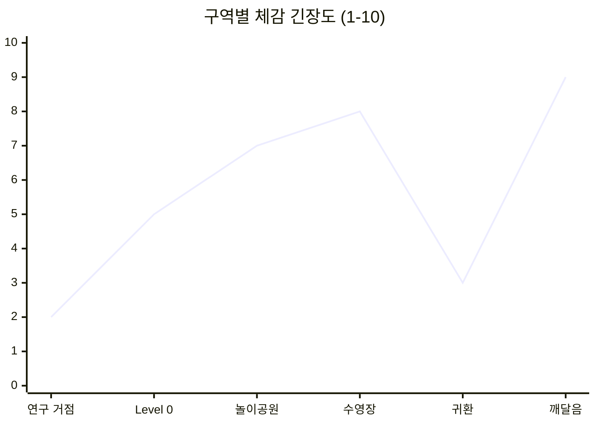

# 핵심 사용자 경험

**안심했다가, 조금씩 틀어지는 공간.**

<a href="01-ProjectOverview.md">01 개요</a> &nbsp;·&nbsp;
<a href="02-ProjectConcept.md">02 컨셉</a> &nbsp;·&nbsp;
<b>03 사용자 경험</b> &nbsp;·&nbsp;
<a href="04-DevelopmentPlan.md">04 개발 계획</a> &nbsp;·&nbsp;
<a href="05-ProductionSchedule.md">05 제작 일정</a>

 

## 무엇을 느끼게 할까

주고 싶은 감정은 하나입니다. **익숙한데 어딘가 틀린 공간에서 오는 불안.**
놀래키는 장면보다 공간 자체가 주는 위화감에 집중합니다.

 

## VR이라서 가능한 세 가지

### 01 &nbsp; 직접 걸어 들어간다
WALK

안전선을 넘는 순간을 화면이 아니라 **내 발걸음으로** 느낍니다.
연구 거점의 조명과 장비 소리가 등 뒤로 멀어지는 것도 체험의 일부입니다.

### 02 &nbsp; 직접 문을 연다
OPEN

손잡이를 잡고 당기는 동작이 곧 **다음 공간으로 넘어가는 전환**입니다.
문 너머가 어떤 곳일지 모르는 상태에서 손을 뻗게 만듭니다.

### 03 &nbsp; 스스로 알아챈다
NOTICE

텍스트나 설명 없이 **공간의 변화만으로** '여기도 백룸'이라는 걸 깨닫게 합니다.
마지막 구역에서 연구진이 없다는 걸 알아채는 순간이 체험의 끝입니다.

 

## 의도한 긴장 곡선

구역을 지날수록 긴장을 올리고, 귀환 구간에서 한 번 풀어준 뒤 마지막에 가장 높게 끌어올립니다.

| 구역 | 연구 거점 | Level 0 | 놀이공원 | 수영장 | 귀환 | 깨달음 |
|:---|:---:|:---:|:---:|:---:|:---:|:---:|
| **긴장도** | `2` | `5` | `7` | `8` | `3` | `9` |
| **감정** | 안심 | 고립감 | 어긋남 | 막막함 | 안도 | 반전 |

> [!TIP]
> 수치는 측정값이 아니라 **연출 설계용 목표치**입니다. 기기 테스트를 하면서 조정합니다.

 

    THE BACKROOMS · FILE 03 / 05
      
    <a href="02-ProjectConcept.md">← 이전: 프로젝트 컨셉</a> &nbsp;·&nbsp; <a href="04-DevelopmentPlan.md">다음: 개발 계획 →</a>

