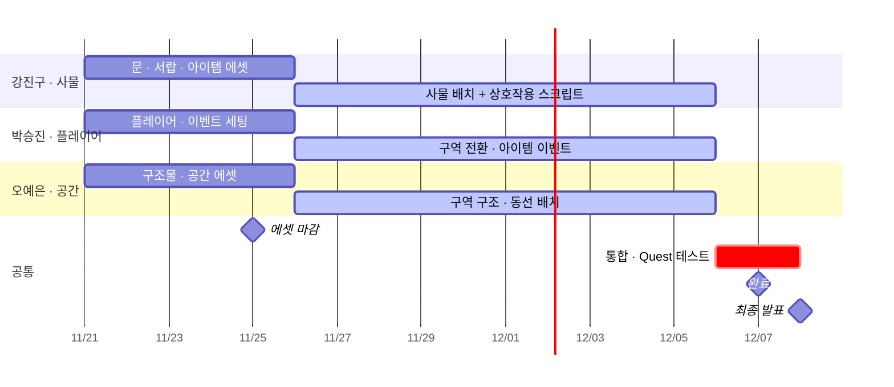

# 제작 일정

**12월 7일 완료, 배치와 개발은 동시에.**

<a href="01-ProjectOverview.md">01 개요</a> &nbsp;·&nbsp;
<a href="02-ProjectConcept.md">02 컨셉</a> &nbsp;·&nbsp;
<a href="03-UserExperience.md">03 사용자 경험</a> &nbsp;·&nbsp;
<a href="04-DevelopmentPlan.md">04 개발 계획</a> &nbsp;·&nbsp;
<b>05 제작 일정</b>

  

 

## 주차별 목표

| 주차 | 기간 | 목표 | 할 일 |
|:---:|:---:|:---|:---|
| **WEEK 1** | 11.21 – 11.25 | **에셋 수집** | 담당 영역별 에셋 수집 · 프리팹 / 머티리얼 정리 · `Assets` 규격 맞춰 등록 |
| **WEEK 2 · 3** | 11.26 – 12.05 | **배치 + 개발 병렬** | 공간 배치와 상호작용 · 이벤트 스크립트를 **동시에** 진행 |
| **WEEK 4** | 12.06 – 12.07 | **통합 · 완료** | 공통 씬 통합 · Meta Quest 빌드 테스트 · 마무리 |
| **발표** | 12.08 | **최종 발표** | |

 

## 담당별 일정

| 담당 | WEEK 1 · 에셋 수집 | WEEK 2 · 3 · 병렬 진행 | WEEK 4 · 통합 |
|:---|:---|:---|:---:|
| **강진구** 사물 · 아이템 | 문 · 서랍 · 아이템 에셋 | 사물 배치 + 상호작용 스크립트 | |
| **박승진** 플레이어 · 이벤트 | 플레이어 · 이벤트 세팅 | 구역 전환 · 아이템 이벤트 | **공통 씬 통합** |
| **오예은** 구조 · 공간 | 구조물 · 공간 에셋 | 구역 구조 · 동선 배치 | **Quest 테스트** |
| **공통** | 11.25 에셋 마감 | 배치 오브젝트 리스트 수시 공유 | |

> [!IMPORTANT]
> **11월 25일: 에셋 마감**
>
> 각자 영역의 에셋을 모아 `Assets/` 아래 프리팹 · 머티리얼로 추가해 둡니다.

> [!IMPORTANT]
> **2 · 3주차 병렬 진행**
>
> 원래는 배치가 끝난 뒤 스크립트를 붙일 계획이었지만, 일정상 **배치와 개발을 동시에** 진행합니다.
> 스크립트는 **프리팹 단위**로 붙여서 서로 기다리지 않게 하고, 배치한 오브젝트 리스트는 톡방에 **수시로** 공유합니다.

> [!WARNING]
> **12월 7일: 최종 완료 (12월 8일 발표)**
>
> 6일까지 각자 작업을 공통 씬에 합치고, 7일에는 Quest 테스트와 마무리만 남깁니다.

 

    THE BACKROOMS · FILE 05 / 05
      
    <a href="04-DevelopmentPlan.md">← 이전: 개발 계획</a> &nbsp;·&nbsp; <a href="../README.md">메인 README</a>

