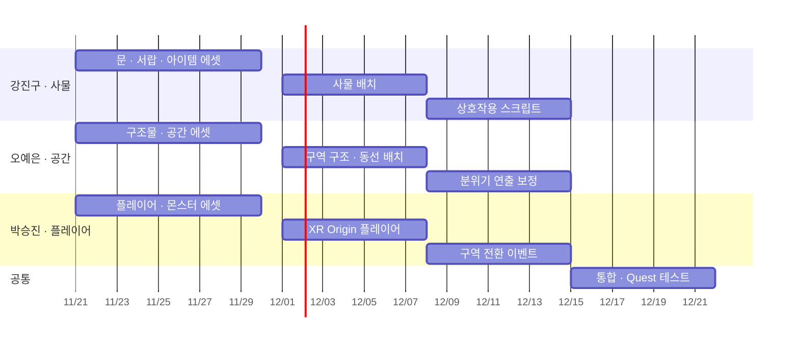

# 제작 일정

**12월 1일 에셋 마감, 그다음은 배치와 스크립트.**

<a href="01-ProjectOverview.md">01 개요</a> &nbsp;·&nbsp;
<a href="02-ProjectConcept.md">02 컨셉</a> &nbsp;·&nbsp;
<a href="03-UserExperience.md">03 사용자 경험</a> &nbsp;·&nbsp;
<a href="04-DevelopmentPlan.md">04 개발 계획</a> &nbsp;·&nbsp;
<b>05 제작 일정</b>

 

## 주차별 목표

| 주차 | 기간 | 목표 | 할 일 |
|:---:|:---:|:---|:---|
| **WEEK 1** | 11.21 – 11.30 | **에셋 수집** | 담당 영역별 에셋 수집 · 프리팹 / 머티리얼 정리 · `Assets` 규격 맞춰 등록 |
| **WEEK 2** | 12.01 – 12.07 | **공간 배치** | 구역별 구조물 · 사물 배치 · 동선 확인 · 배치 오브젝트 리스트업 |
| **WEEK 3** | 12.08 – 12.14 | **이벤트 개발** | 사물별 스크립트 반영 · 문 / 서랍 / 아이템 동작 · 구역 전환 연결 |
| **WEEK 4** | 12.15 – | **통합 · 검증** | 공통 씬 통합 · Meta Quest 빌드 테스트 · 몬스터 추가 여부 결정 |

> [!IMPORTANT]
> **12월 1일 — 에셋 마감**
>
> 각자 영역의 에셋을 모아 `Assets/` 아래 프리팹 · 머티리얼로 추가해 둡니다.

> [!IMPORTANT]
> **12월 7일 — 배치 완료 · 리스트 공유**
>
> 배치한 오브젝트를 **전부 리스트업**해서 팀 톡방에 공유합니다. 3주차 스크립트 작업은 이 리스트를 기준으로 진행합니다.

 

## 담당별 일정

> [!NOTE]
> 4주차 종료일은 **최종 발표 일정에 맞춰** 조정합니다.

 

    THE BACKROOMS · FILE 05 / 05
      
    <a href="04-DevelopmentPlan.md">← 이전: 개발 계획</a> &nbsp;·&nbsp; <a href="../README.md">메인 README</a>

